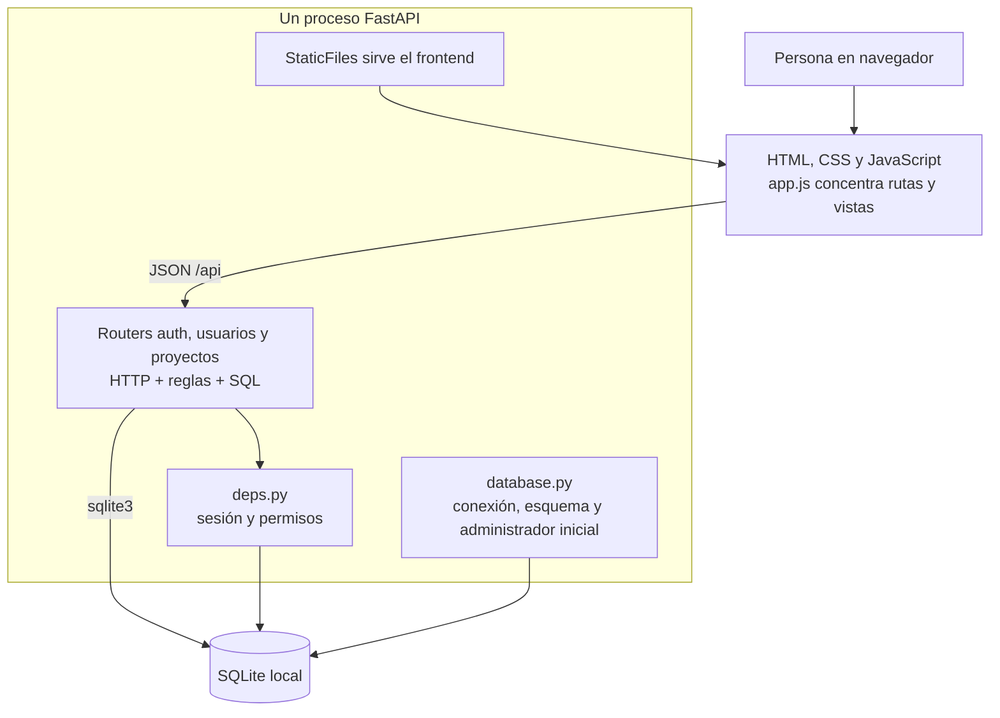
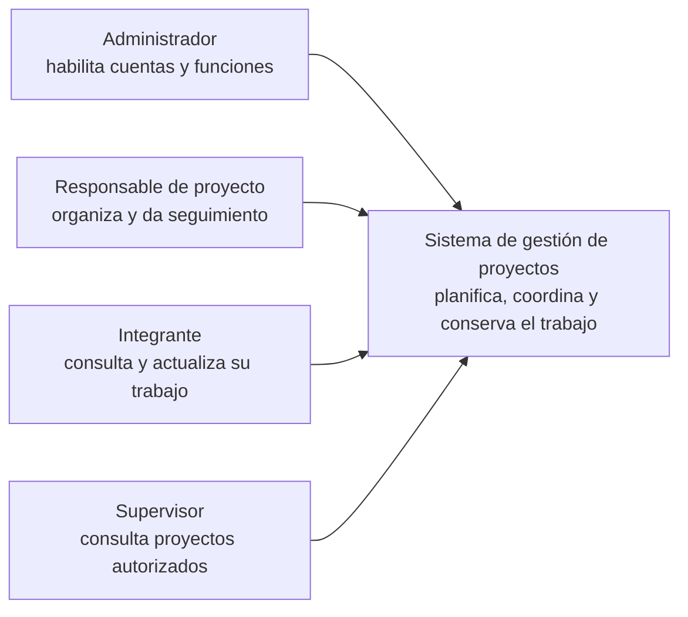
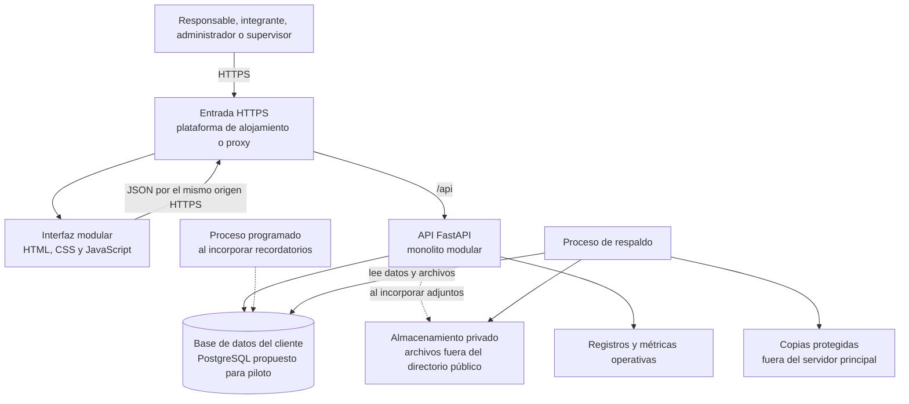
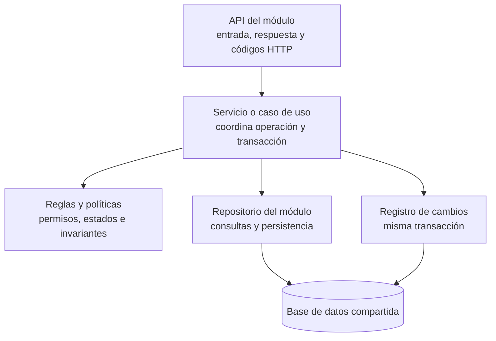
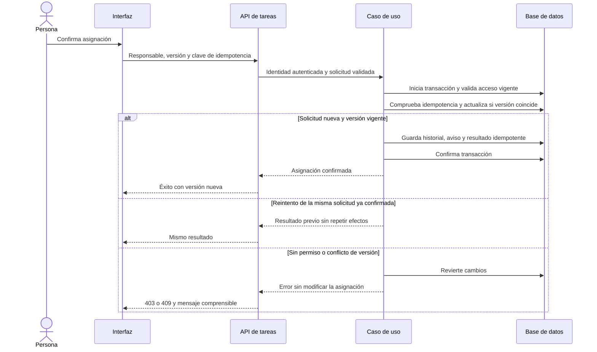

# Arquitectura del sistema de gestión de proyectos

**Revisión:** 30 de octubre de 2026. **Estado:** propuesta técnica para discusión del equipo. La arquitectura objetivo todavía no está implementada.

La base actual permite demostrar el primer recorrido de acceso y proyectos. Para convertirla en un producto mantenible recomiendo un **monolito modular con FastAPI**, reglas de negocio separadas de HTTP y persistencia, migraciones y un despliegue reproducible. El mayor beneficio inmediato es poder añadir tareas, historial y avisos sin repartir las mismas reglas entre varias rutas y pantallas.

Se revisaron el código del Sprint 1, las pruebas existentes, el flujo de GitHub Actions, README, descripción general en Word, épicas, story mapping, planificación y las dos fotografías. Los documentos de producto se presentan como propuestas pendientes de validación; no equivalen a acuerdos comerciales. Las anotaciones de las fotos se consideran evidencia de requisitos, no instrucciones para ejecutar acciones.

## 1. Requisitos de entrega y evidencia disponible

La segunda foto permite leer proyecto base «Hello World», Git funcionando, arquitectura, historias definidas y organización de historias. En la primera se distinguen estructura del proyecto, pruebas automatizadas, GitHub Actions, arquitectura base con referencia a C4 y completar dos historias. Hay trazos borrosos: no se puede asegurar la redacción exacta ni interpretar las marcas por grupo como fechas o criterios para este equipo.

| Elemento observado | Evidencia local | Qué falta para demostrarlo |
| --- | --- | --- |
| Proyecto base ejecutable | `backend/app/main.py` monta la API y sirve el frontend | Arranque desde instalación limpia y demostración en navegador |
| Git funcionando | Repositorio con commits de primera iteración y documentación | Verificar que el remoto contiene lo que se presentará; no se inspeccionó el servidor remoto |
| Estructura y arquitectura | Carpetas backend/frontend; este documento incluye estado actual y propuesta | Explicar responsabilidades y distinguir componentes actuales de futuros |
| Historias definidas y organizadas | Ocho épicas, 48 HU y planificación de seis sprints | Validar prioridades con cliente y actualizar el estado de cada historia |
| Pruebas automatizadas y GitHub Actions | Ocho pruebas en `backend/tests/test_sprint1.py`; `.github/workflows/ci.yml` ejecuta pytest | Adjuntar una ejecución verde de CI; su existencia no prueba que haya pasado |
| Completar dos historias | HU-01-003 iniciar sesión y HU-02-001 crear proyecto tienen rutas, interfaz y pruebas asociadas | Demostrar criterios de ambas y registrar resultado de pruebas; login de cuenta inactiva no tiene caso explícito |

El código cubre más de dos historias, pero no se debe presentar una historia como terminada solo por tener un endpoint. La definición de terminado exige criterios, pruebas, revisión e integración. El encabezado del story mapping dice «aún no implementadas», mientras README describe cobertura del Sprint 1: conviene registrar estado por HU y evidencia sin confundir implementación con aprobación del cliente.

## 2. Arquitectura actual



Hay decisiones que conviene conservar: SQL parametrizado, claves foráneas activadas por conexión, validación Pydantic, contraseña con sal y comparación resistente a diferencias de tiempo, tokens aleatorios y cierre de sesión en servidor. La autorización consulta cuenta y función en cada petición, y restringe proyectos por participación incluso al administrador. Crear proyecto y participantes se confirma con un único commit. La interfaz distingue error de guardado y usa una función de escape para muchos textos.

### Hallazgos concretos

Prioridad A significa atender antes de usar datos reales; B, resolver al introducir la función que depende de ello.

| Prioridad | Evidencia en el código | Consecuencia y mejora |
| --- | --- | --- |
| A | `database.py:67–82` crea `admin / Admin123!` al iniciar si no hay cuentas | Una instalación nueva tiene una credencial conocida. Separar datos de demostración y aprovisionamiento seguro del primer administrador; producción debe rechazar ese arranque inseguro |
| A | `sesiones` solo tiene token, usuario y creación; `deps.py:28` no comprueba vencimiento; `api.js:3–8` guarda token en localStorage | Sesiones sin caducidad y secreto accesible a JavaScript. Proponer sesión opaca en cookie HttpOnly/Secure/SameSite con protección CSRF y expiración en servidor; almacenar un hash del token |
| A | `security.py:5–20` usa PBKDF2-SHA256 con 100 000 iteraciones y formato que no guarda algoritmo/coste | Actualizar la política de hash y conservar compatibilidad con los hashes existentes. Rehash al autenticar con éxito; no basta con cambiar la constante |
| A | `database.py` usa `CREATE TABLE IF NOT EXISTS`; `main.py:16–18` lo ejecuta al arrancar | Crear tablas no actualiza esquemas existentes. Incorporar migraciones versionadas, ejecutadas como paso de despliegue, y probar actualización con datos |
| A | No hay procedimiento de respaldo/restauración ni configuración de operación en el repositorio | Incorporar ambos antes del primer piloto con datos reales; no esperar al último sprint para poder recuperar trabajo |
| B | `routers/proyectos.py` y `routers/usuarios.py` contienen reglas, SQL y commits | Extraer casos de uso y repositorios. Las reglas deben poder probarse sin una petición HTTP |
| B | `_agregar_participante`, `proyectos.py:9–15`, sustituye fechas al reactivar | La fila representa el acceso vigente, no un historial completo. Guardar eventos de alta, retiro y reincorporación en la misma transacción |
| B | `schemas.py` aplica `str_strip_whitespace=True` a todos los textos, incluidas contraseñas | La API transforma silenciosamente la contraseña. Separar validación de identificadores y secretos; preservar el valor exacto del secreto |
| B | `frontend/js/app.js` concentra navegación, formularios, acceso y renderizado | Separar vistas por función y componentes compartidos antes de añadir tablero y tareas |
| B | Listados de proyectos y usuarios no tienen paginación | Definir tamaños máximos, filtros e índices con consultas y volumen reales; no cargar todos los usuarios para cualquier selector |
| B | `app.js:38–43` ignora errores de logout y borra la sesión local | Si falla la comunicación, el token puede seguir válido en servidor. Informar el cierre incompleto y apoyarse en revocación y vencimiento |

Las recomendaciones sobre cookies, expiración y exposición de tokens se apoyan en [OWASP Session Management](https://cheatsheetseries.owasp.org/cheatsheets/Session_Management_Cheat_Sheet.html). Para contraseñas, [OWASP Password Storage](https://cheatsheetseries.owasp.org/cheatsheets/Password_Storage_Cheat_Sheet.html) recomienda Argon2id y publica parámetros para PBKDF2; el coste debe medirse en el equipo de despliegue. Estos hallazgos proceden de lectura de código, no de una auditoría de penetración.

## 3. Decisión de arquitectura y límites

La propuesta mantiene una aplicación y una base de datos por cliente para la primera venta. Es un supuesto de diseño, pendiente de confirmar. Con tres desarrolladores previstos en la planificación, un monolito modular permite entregas pequeñas y transacciones sencillas. Los módulos son límites internos de código; no implican servidores separados.

FastAPI ya ofrece routers e inyección de dependencias para componer aplicaciones por módulos; la separación adicional de servicios y repositorios es una decisión de este proyecto, no una exigencia del framework. Véase [aplicaciones grandes en FastAPI](https://fastapi.tiangolo.com/tutorial/bigger-applications/).

La entrega académica puede continuar con SQLite. Para el piloto comercial propongo PostgreSQL si se confirma escritura concurrente, varios procesos o mayor necesidad operativa. SQLite también puede servir una aplicación web pequeña: no se ha medido saturación y no hay evidencia de un problema de rendimiento actual. Su documentación describe el límite de un escritor simultáneo y los criterios para elegir una base cliente/servidor: [usos apropiados de SQLite](https://www.sqlite.org/whentouse.html).

No propongo añadir microservicios, Kubernetes, Redis, un bus de eventos ni reescribir toda la interfaz en esta etapa. Se reevaluarán solo ante una necesidad medida. El frontend puede seguir en JavaScript, dividido en módulos ES; adoptar otro framework requiere valorar experiencia del equipo, alcance y coste de migración.

Si la intención comercial pasa a ser una plataforma compartida por varias empresas, deberá abrirse una decisión nueva: aislamiento por organización en autenticación, consultas, relaciones, índices únicos, archivos, trabajos y respaldos, con pruebas de acceso cruzado. Añadir únicamente `organizacion_id` no resuelve ese aislamiento.

## 4. Vista de contexto y despliegue propuesto

La persona utiliza un sistema web de gestión; los servicios de archivos y respaldos son infraestructura del producto. No se presupone correo externo, portal de clientes ni integraciones, pues el alcance todavía no los confirma.

Vista de contexto del sistema, correspondiente al nivel 1 de C4:



Vista simplificada de contenedores de destino, correspondiente al nivel 2 de C4:



Los diagramas documentan relaciones; no certifican despliegue ni alta disponibilidad. La entrada HTTPS puede venir del alojamiento; no requiere comprar un servicio adicional. Inicialmente FastAPI puede seguir sirviendo los archivos estáticos. La base y el almacenamiento privado no se exponen directamente al navegador.

Líneas discontinuas indican capacidades de sprints posteriores. Los respaldos son requisito antes de datos reales e incluyen base y adjuntos cuando existan. Un servidor único es aceptable para un piloto con disponibilidad acordada, pero su caída afecta la aplicación; la alta disponibilidad depende del compromiso y presupuesto del cliente.

## 5. Organización interna propuesta

| Módulo | Responsabilidad y datos que administra | Trazabilidad |
| --- | --- | --- |
| Acceso | Cuentas, funciones, autenticación y sesiones; permisos generales | EP-01 |
| Proyectos | Ficha, ciclo de vida, responsable y participación | EP-02; HU-01-005 y HU-01-006 |
| Tareas | Asignación, estados, avances y bloqueos | EP-03 y EP-04 |
| Colaboración | Comentarios y metadatos de archivos; descarga autorizada | EP-05 |
| Notificaciones | Avisos, lectura y recordatorios sin duplicados | EP-06 |
| Reportes | Consultas e indicadores sobre datos autorizados; sin segundo estado de tareas | EP-07 |
| Infraestructura compartida | Configuración, persistencia, transacciones, auditoría, registros y recuperación | EP-08 y controles transversales |



Una estructura de destino posible, creada gradualmente, es:

```text
backend/
  app/
    main.py                       # compone la aplicación
    core/                         # configuración, seguridad y errores comunes
    infrastructure/               # conexión, transacciones y almacenamiento
    modules/
      acceso/                     # api, schemas, service y repository
      proyectos/                  # api, schemas, service, policies y repository
      tareas/                     # se crea con las HU de tareas
      colaboracion/               # se crea con comentarios y archivos
      notificaciones/             # se crea con avisos
      reportes/                   # se crea con tablero y resúmenes
  migrations/                     # cambios de esquema versionados
  tests/                          # reglas, integración API/BD y recorridos críticos
frontend/
  js/
    core/                         # cliente HTTP, navegación y sesión
    components/                   # avisos, formularios y elementos comunes
    features/                     # vistas de acceso, proyectos, tareas y tablero
docs/
  Arquitectura_Gestion_Proyectos.md
  diagramas/
```

No es necesario crear carpetas vacías para funciones futuras. Cada módulo empieza pequeño. Las rutas traducen errores a HTTP; los servicios deciden las reglas y el inicio/fin de transacción; los repositorios no hacen commits independientes. Un módulo no debe modificar tablas de otro saltándose su servicio. Reportes puede tener consultas conjuntas de lectura, siempre filtradas por acceso vigente. Las dependencias entre módulos deben evitar ciclos.

Como opción de implementación, SQLAlchemy puede unificar persistencia y transacciones y Alembic registrar cambios de esquema. No vuelven portátil cualquier SQL automáticamente: hay que revisar tipos, fechas, autoincrementos y `ON CONFLICT`, y ejecutar pruebas contra PostgreSQL si ese será el motor de producción. Referencias: [transacciones de SQLAlchemy](https://docs.sqlalchemy.org/en/20/orm/session_transaction.html) y [migraciones de Alembic](https://alembic.sqlalchemy.org/en/latest/).

## 6. Integridad y seguridad de las operaciones

Una operación debe confirmar todos los cambios relacionados o ninguno. Por ejemplo, al asignar una tarea: comprobar cuenta activa y acceso al proyecto, validar el nuevo responsable, cambiar la asignación, añadir historial y crear el aviso interno dentro de la misma transacción. Si el aviso es solo una fila local, no requiere una cola. Correo u otros efectos externos futuros pueden usar una bandeja transaccional y un proceso con reintentos; no deben bloquear la petición ni perderse después del commit.



El flujo es futuro; no describe los endpoints actuales. La comprobación de permisos y la mutación deben tener una estrategia de concurrencia coherente para que una revocación simultánea no deje abierta una ventana de escritura.

Para HU-08-002, guardar una clave de idempotencia acotada a usuario y operación, huella del contenido y respuesta. Una restricción única resuelve peticiones simultáneas; misma clave con contenido diferente devuelve conflicto. La interfaz conserva la clave durante el reintento y usa una nueva para otra intención. Deshabilitar un botón por sí solo no evita duplicados.

Para HU-08-003, añadir `version` y actualizar con condición sobre la versión leída. Si no se actualiza ninguna fila, informar 409 y ofrecer recargar sin perder silenciosamente lo escrito. Es distinto de la idempotencia: resuelve cambios concurrentes, no reenvíos.

La participación activa continúa siendo la fuente de acceso al proyecto. Rol global, participación y acción permitida se evalúan juntos; archivos, avisos y reportes usan el mismo alcance. Debe aclararse qué ocurre si un responsable pierde su función global, si un supervisor puede actualizar una tarea propia y quién sustituye a un responsable desactivado. No se cambiarán estas reglas por conveniencia de la interfaz.

Auditoría registra actor, fecha UTC, acción, recurso y valores relevantes, sin contraseñas ni tokens. Una fila de participante activo y un evento de acceso cumplen funciones distintas. Fechas límite que representan un día se almacenan como fecha; instantes como UTC, con zona de la organización para presentar y calcular vencimientos.

Los archivos se incorporan con metadatos en BD y contenido privado: tamaño y tipos permitidos, identificador interno, descarga autenticada, límites de cuota y estrategia de limpieza ante cargas fallidas. Nunca se sirven desde la carpeta pública del frontend. El proceso de revisión de archivos dependerá de los tipos y riesgos acordados.

## 7. Operación y optimización que sí aportan valor

Antes del piloto: configuración por entorno; primer administrador aprovisionado de forma segura; HTTPS; caducidad y revocación de sesiones; límites de intentos de acceso; manejo uniforme de errores; datos persistentes fuera del código y de carpetas sincronizadas; respaldos y restauración ensayada. OneDrive no sustituye un respaldo consistente de la base en uso.

El formato de errores debe permitir distinguir validación, falta de acceso y conflicto sin exponer SQL ni trazas al usuario. Mantener inicialmente las rutas `/api` y sus respuestas durante la reorganización reduce el riesgo para el frontend y las pruebas.

La integración continua debe instalar versiones reproducibles, comprobar sintaxis y ejecutar pruebas de reglas e integración. Separar dependencias de ejecución y desarrollo; fijar el conjunto resuelto para releases. La canalización existe en la ubicación correcta, pero no se comprobó una ejecución remota ni se modificaron versiones de paquetes durante esta revisión.

El despliegue debe usar un artefacto versionado y un paso explícito de migración. Definir cómo recuperar código y datos si falla una actualización; un respaldo previo no reemplaza un procedimiento de recuperación probado. Los registros operativos deben incluir identificador de petición y errores sin secretos; salud del proceso, disponibilidad de BD y resultado del último respaldo deben ser observables.

Optimizar con mediciones: paginar listados, limitar resultados, añadir índices según consultas frecuentes y verificar sus planes. Candidatos a evaluar: participación por usuario/activo/proyecto, tareas por proyecto/estado y responsable/fecha, avisos por destinatario/leído. No duplicar índices ya cubiertos por claves. Reportes calculan sobre datos confirmados; no introducir caché antes de comprobar necesidad e invalidación correcta.

Antes de prometer rendimiento, acordar usuarios simultáneos, volumen de proyectos/tareas, tamaño de adjuntos y recorridos de prueba; medir percentil 95 de respuesta con esos datos. Acordar también pérdida máxima de datos, tiempo de recuperación, retención, disponibilidad y responsable de soporte. No hay todavía resultados de carga ni compromisos de servicio validados.

## 8. Orden de implementación

| Momento | Trabajo propuesto | Evidencia para cerrarlo |
| --- | --- | --- |
| Entrega actual | Explicar esta arquitectura; demostrar dos HU; registrar CI y ejecución limpia | Recorrido login → crear proyecto → consulta autorizada y rechazo sin acceso; criterios documentados |
| Antes de ampliar Sprint 2 | Extraer servicio/repositorio de proyectos conservando API; dividir vistas; introducir configuración y migración inicial | Mismas pruebas de API; regla de creación probada fuera de HTTP; actualización sin perder datos |
| Sprint 2 | Tareas, asignación e idempotencia; historial desde el primer cambio | Un reenvío concurrente crea una sola tarea y conserva una sola intención de negocio |
| Sprint 3 | Versionado, conflictos y consultas paginadas del tablero | Dos editores no se sobrescriben; cifras y permisos coinciden con el detalle |
| Sprint 4 | Comentarios, adjuntos privados y avisos transaccionales | Descarga no autorizada rechazada; un cambio confirmado no pierde ni duplica su aviso |
| Sprint 5 | Recordatorios programados y supervisión | Proceso repetido o ejecutado por dos instancias no duplica avisos |
| Antes de cualquier piloto real | Seguridad de acceso, motor de BD decidido, despliegue reproducible, respaldo/restauración y soporte | Instalación nueva segura, migración con datos, restauración en entorno separado y criterios operativos acordados |

La condición del piloto se aplica aunque algunas funciones previstas para sprints posteriores se pospongan. Esto adelanta la base de recuperación de HU-08-004/005 y las decisiones de acceso necesarias, sin afirmar que esas historias ya estén terminadas. El Sprint 1 suma 31 puntos frente a la velocidad estimada de 25–30; agregar trabajo exige reestimar o retirar alcance, no mantener la misma promesa automáticamente.

## 9. Decisiones pendientes y validación de esta revisión

Confirmar con el cliente: instalación dedicada o plataforma compartida; volumen real y entorno de alojamiento; matriz de permisos; reglas de cierre y reasignación; tipos y cuotas de archivos; avisos indispensables; zona horaria; objetivos de recuperación y soporte. La propuesta de instalación dedicada permite avanzar, pero no debe convertirse en una promesa comercial sin validación.

Se comprobó estructura, historial local, referencias, sintaxis Python/JavaScript y definición de CI. Se intentó ejecutar pytest: el Python disponible no tenía FastAPI, pytest ni httpx. Se intentó instalar las dependencias en una carpeta temporal aislada, pero la resolución de `pypi.org` falló. Por ello **no se certifica el resultado de las ocho pruebas ni de una ejecución en navegador**. No se modificó lógica de aplicación ni se ejecutaron cambios en una base con datos del usuario.

Los cinco diagramas editables se encuentran en `docs/diagramas`: `arquitectura-actual.mmd`, `contexto.mmd`, `arquitectura-propuesta.mmd`, `componentes-modulo.mmd` y `asignacion-tarea.mmd`. La lectura de código sustenta los hallazgos; las fuentes oficiales enlazadas sustentan las recomendaciones generales. La selección del monolito modular, sus límites y su secuencia son juicio de diseño para este proyecto.
