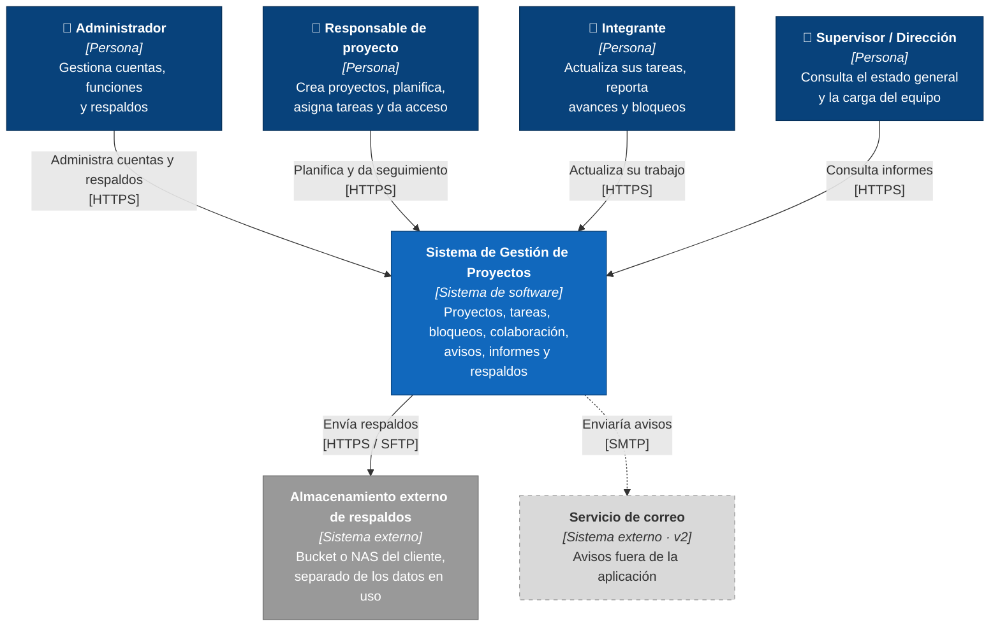
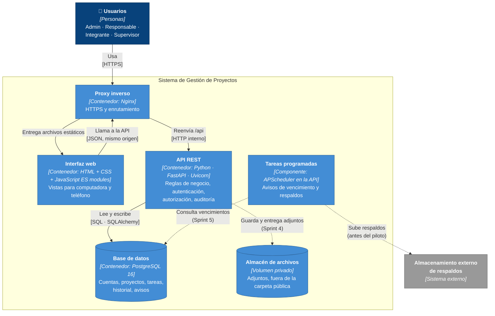
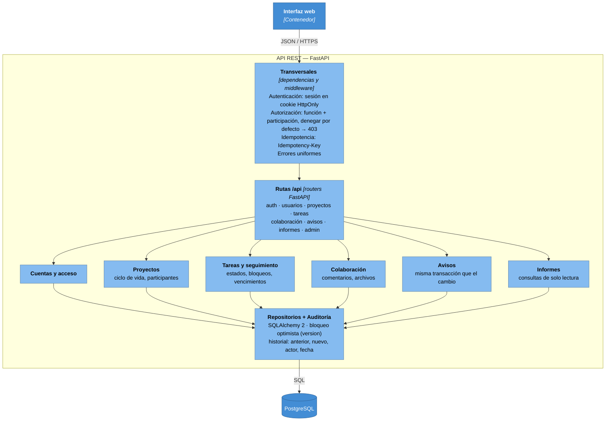
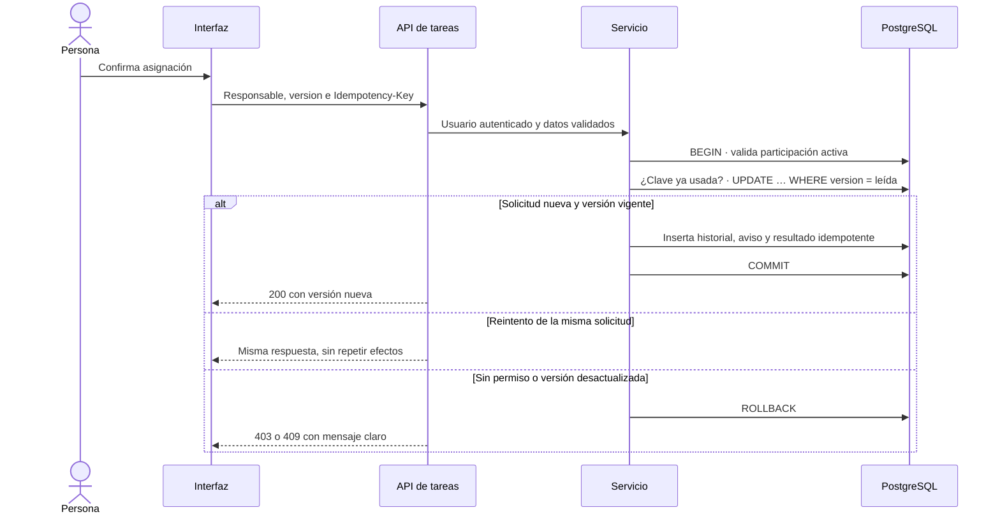
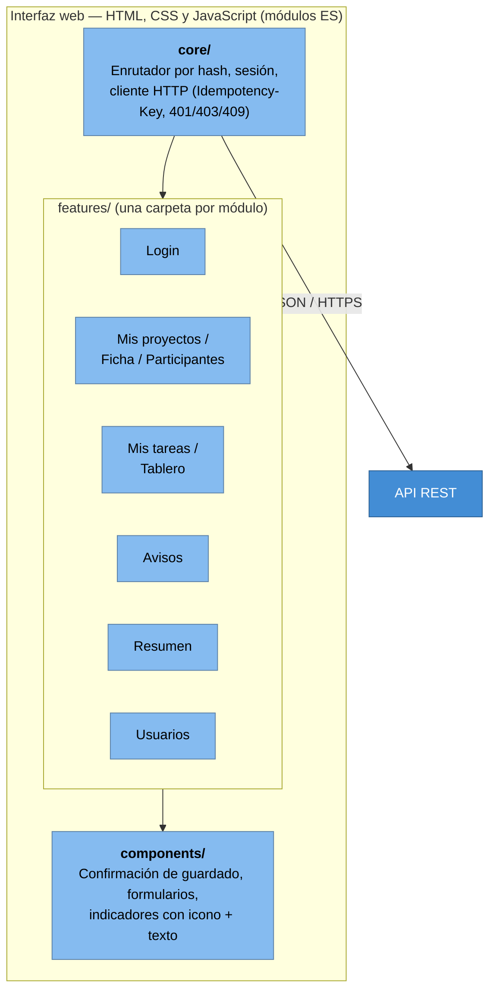
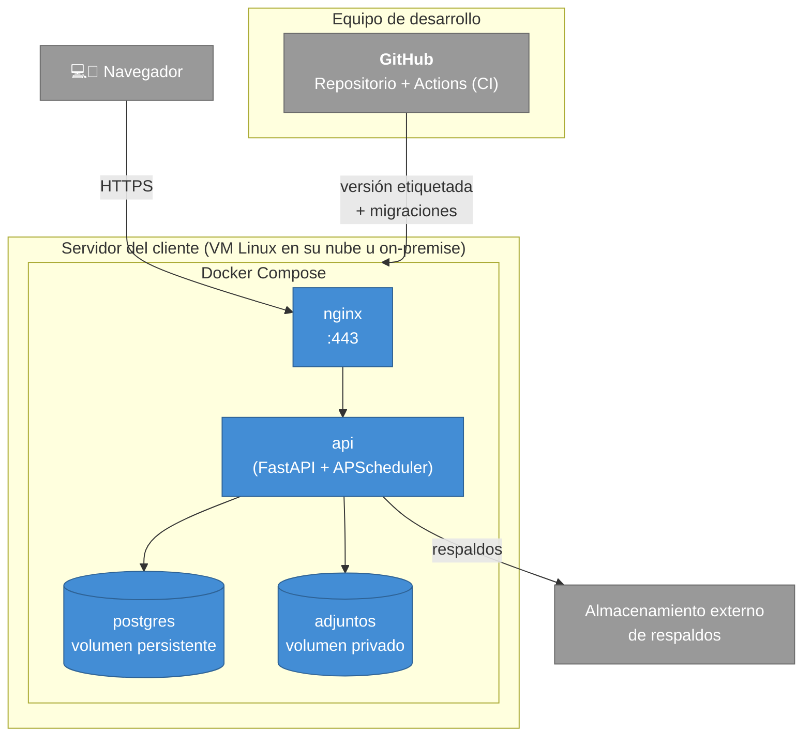

# Arquitectura C4 — Sistema de Gestión de Proyectos

**Versión:** combinada (C4 de Fabián + revisión de código de Angel) · 6 de noviembre de 2026
**Fuentes:** `Epicas_Gestion_Proyectos.md`, `UserStoryMapping_Gestion_Proyectos.md`, `Planning_Sprints_ProjectManagement.md` y el código del Sprint 1.
**Modelo de entrega:** producto para **un solo cliente** (single-tenant), instalado en su infraestructura o en una nube a su nombre.
**Stack:** Python · FastAPI · PostgreSQL · HTML/CSS/JavaScript (módulos ES) · Docker Compose · GitHub Actions

**Principio:** la arquitectura se construye **de forma incremental**, una historia a la vez. Se parte del MVP del Sprint 1 y solo se agrega una pieza cuando una historia la necesita. No se reescribe lo que ya funciona.

| Nivel C4 | Pregunta que responde | Sección |
|---|---|---|
| 1. Contexto | ¿Quién usa el sistema y con qué se comunica? | §1 |
| 2. Contenedores | ¿Qué aplicaciones y almacenes de datos lo forman? | §2 |
| 3. Componentes | ¿Cómo está organizada por dentro la API y la interfaz? | §3 |
| 4. Código | ¿Cómo se refleja en el repositorio? | §4 |
| Complementario | ¿Dónde y cómo se despliega? | §5 |

**Convención de colores:** azul oscuro = persona · azul = parte del sistema · gris = sistema externo · línea punteada = se agrega en un sprint posterior.

---

## 1. Diagrama de Contexto (Nivel 1)



**Notas**
- Las cuatro funciones son el catálogo de HU-01-002. Cada persona tiene una función, y el acceso a cada proyecto depende además de que sea participante (HU-01-005/007).
- En la v1 los avisos son solo dentro de la aplicación (EP-06). El correo queda como extensión, pendiente de confirmar con el cliente.
- Los respaldos se guardan **separados** de la información en uso (HU-08-004).

---

## 2. Diagrama de Contenedores (Nivel 2)



| Contenedor | Tecnología | Responsabilidad | Épicas | Desde |
|---|---|---|---|---|
| Proxy inverso | Nginx | HTTPS, cabeceras de seguridad, sirve la interfaz, enruta `/api` | Todas | Despliegue |
| Interfaz web | HTML, CSS, JavaScript en módulos ES | Vistas, formularios, tablero, confirmación de guardado | EP-01 a EP-07 | Sprint 1 |
| API REST | FastAPI, Pydantic v2, SQLAlchemy 2, Alembic | Lógica de negocio, permisos, historial, idempotencia, concurrencia | EP-01 a EP-08 | Sprint 1 |
| Tareas programadas | APScheduler dentro del proceso de la API | Avisos de vencimiento, respaldos, limpieza de sesiones | EP-06, EP-08 | Sprint 5 |
| Base de datos | PostgreSQL 16 (SQLite solo en el MVP del Sprint 1) | Fuente de verdad: integridad referencial y transacciones | Todas | Sprint 2 |
| Almacén de archivos | Volumen privado (cambiable a S3 del cliente) | Adjuntos; nunca en la carpeta pública | EP-05 | Sprint 4 |

En desarrollo, FastAPI puede seguir sirviendo la interfaz como en el MVP. Nginx entra cuando se despliega.

---

## 3. Diagramas de Componentes (Nivel 3)

### 3.1 API REST

La API usa **capas**: rutas → servicios → repositorios. Las rutas no contienen reglas de negocio y los servicios no saben de HTTP.



| Componente | Responsabilidad | HU clave |
|---|---|---|
| Autenticación | Token de sesión opaco en cookie HttpOnly/Secure/SameSite; en BD se guarda su **hash** con fecha de expiración; revocable al cerrar sesión. Contraseñas con Argon2id (rehash de las PBKDF2 existentes al iniciar sesión) | HU-01-003, 01-004 |
| Autorización | Toda ruta declara su permiso; se verifica **función** y **participación activa** en el proyecto, consultando la BD en cada petición | HU-01-006, 01-007, 05-002 |
| Idempotencia | Guarda `Idempotency-Key` + usuario + huella del contenido + respuesta; una restricción única resuelve reintentos simultáneos. Misma clave con contenido distinto → 409 | HU-08-002 |
| Bloqueo optimista | Columna `version` en proyectos y tareas; `UPDATE … WHERE version = :leida`; si no se actualiza ninguna fila → **409 Conflicto** | HU-08-003 |
| Auditoría | Cada cambio registra entidad, campo, valor anterior, valor nuevo, actor y fecha UTC, en la **misma transacción**. Nunca guarda contraseñas ni tokens | HU-04-006, 02-006, 01-010 |
| Avisos | Se insertan en la **misma transacción** que el cambio que los origina: no se pierden ni se duplican | HU-06-001, 06-003, 06-004 |
| Informes | Consultas de solo lectura, siempre filtradas por proyectos autorizados | HU-07-003 a 07-005 |

**Flujo de una operación concurrente (ejemplo: asignar una tarea)**



### 3.2 Interfaz web



El `app.js` actual se divide en estos módulos **antes** de agregar tareas y tablero. No se adopta un framework de frontend en la v1; se reevalúa si el tablero lo exige.

---

## 4. Nivel de Código — Estructura del repositorio

Las carpetas se crean cuando llega la historia que las necesita; no se crean vacías.

```
ProjectManagement/
├── .github/workflows/ci.yml      # pruebas en cada push y PR
├── backend/
│   ├── app/
│   │   ├── main.py               # compone la aplicación
│   │   ├── core/                 # configuración, seguridad, errores
│   │   ├── db/                   # conexión y transacciones
│   │   └── modules/
│   │       ├── acceso/           # router · schemas · service · repository
│   │       ├── proyectos/
│   │       ├── tareas/           # Sprint 2
│   │       ├── colaboracion/     # Sprint 4
│   │       ├── avisos/           # Sprint 4
│   │       └── informes/         # Sprint 5
│   ├── migrations/               # Alembic: cambios de esquema versionados
│   ├── tests/                    # reglas, integración API/BD
│   └── requirements.txt
├── frontend/
│   ├── index.html
│   ├── css/
│   └── js/
│       ├── core/
│       ├── components/
│       └── features/
├── docker-compose.yml            # api + postgres (+ nginx en despliegue)
└── docs/
    └── Arquitectura_Gestion_Proyectos.md
```

**Reglas de dependencia**
- El router solo llama a su `service`; traduce errores a códigos HTTP.
- El `service` decide reglas y abre/cierra la transacción; puede usar **servicios** de otros módulos, nunca sus repositorios.
- Los repositorios no hacen `commit` por su cuenta.
- `modules/*/service.py` no importa FastAPI, para que las reglas se prueben sin HTTP.

---

## 5. Diagrama de Despliegue



| Entorno | Dónde | Uso |
|---|---|---|
| Local | `uvicorn` + PostgreSQL en Docker | Desarrollo y pruebas |
| Demo | VM pequeña o servicio gratuito | Revisión al final de cada sprint |
| Producción | Servidor del cliente | Uso real, después de cumplir §8 |

Solo Nginx expone puertos. PostgreSQL y los adjuntos viven en la red interna de Docker.

---

## 6. Decisiones de arquitectura (ADR)

| # | Decisión | Motivo | Alternativa descartada |
|---|---|---|---|
| ADR-01 | **Monolito modular** | 3 desarrolladores y un solo cliente: transacciones simples, menos operación | Microservicios: costo operativo alto |
| ADR-02 | **Single-tenant** | Se vende a un cliente; no hace falta `organizacion_id` | Multi-tenant: complejidad innecesaria |
| ADR-03 | **PostgreSQL + SQLAlchemy 2 + Alembic** desde el Sprint 2 | Transacciones y concurrencia reales (varios escritores); migraciones sin perder datos | SQLite: un solo escritor a la vez, se queda solo en el MVP |
| ADR-04 | **HTML/CSS/JS en módulos ES** | Ya funciona en el Sprint 1; el equipo lo domina; se evita reescribir | React + TS: buena opción a futuro, pero reescribir ahora no aporta valor a las historias |
| ADR-05 | **Sesión opaca en cookie HttpOnly** con expiración | Continúa el diseño actual y corrige sus riesgos; revocable de inmediato | JWT: revocación más compleja; token en `localStorage`: accesible a JavaScript |
| ADR-06 | **Bloqueo optimista** (`version`) | Evita sobrescribir cambios ajenos sin bloquear a nadie | Bloqueo pesimista: mala experiencia |
| ADR-07 | **Idempotency-Key** en creaciones | Reintentos seguros tras doble clic o corte de red | Solo deshabilitar el botón: no cubre cortes de red |
| ADR-08 | Avisos dentro de la app con **polling** (30 s) | Alcance de EP-06; simple y confiable | WebSockets: v2 si se necesita |
| ADR-09 | Tareas programadas con **APScheduler** en la API | Pocas tareas periódicas; sin servicios extra | Celery + Redis: se justifica solo con trabajos pesados o varias réplicas |
| ADR-10 | **Docker Compose** para desplegar | Fácil de instalar y mantener donde el cliente | Kubernetes: excesivo para un cliente |

---

## 7. Estado actual (Sprint 1) y mejoras detectadas

El MVP del Sprint 1 (FastAPI + SQLite + HTML/JS) implementa: registrar cuenta, asignar función, iniciar y cerrar sesión, crear proyecto, dar/retirar acceso, mis proyectos, ficha del proyecto y rechazo de accesos no autorizados. Tiene 8 pruebas automatizadas y un pipeline en GitHub Actions.

**Se conserva:** SQL parametrizado, claves foráneas activas, validación con Pydantic, contraseñas con sal, tokens aleatorios, permisos consultados en cada petición y creación de proyecto en un solo commit.

**Mejoras detectadas en el código** (A = antes de usar datos reales; B = al llegar la historia que depende de ello):

| Prioridad | Hallazgo | Mejora |
|---|---|---|
| A | `database.py` crea `admin / Admin123!` al arrancar | Crear el primer administrador con un comando de instalación; en producción rechazar el arranque sin él |
| A | Sesiones sin expiración y token en `localStorage` | Cookie HttpOnly con expiración y hash del token en BD (ADR-05) |
| A | PBKDF2 sin registrar algoritmo ni costo | Argon2id; rehash al iniciar sesión |
| A | `CREATE TABLE IF NOT EXISTS` al arrancar | Migraciones con Alembic |
| A | Sin respaldo ni restauración | Respaldo y restauración probada antes del piloto |
| B | Rutas con reglas, SQL y commits mezclados | Separar en service y repository (§4) |
| B | `str_strip_whitespace` también recorta contraseñas | Excluir los campos secretos |
| B | Reactivar un participante sobrescribe sus fechas | Guardar el historial de altas y bajas |
| B | `app.js` concentra todas las vistas | Dividir en `core/`, `components/` y `features/` |
| B | Listados sin paginación | Paginar e indexar según las consultas reales |

---

## 8. Trazabilidad con el planning

| Sprint | Se construye |
|---|---|
| 1 ✅ | MVP: acceso, cuentas, proyectos, participantes; CI con pruebas |
| 2 | Refactor a módulos (service/repository) · PostgreSQL + Alembic · Tareas · Auditoría · Idempotencia |
| 3 | Bloqueo optimista · tablero y filtros · vista de historial · paginación |
| 4 | Avisos transaccionales · comentarios · adjuntos en volumen privado |
| 5 | APScheduler: avisos de vencimiento · informes generales · cierre de proyecto |
| 6 | Seguridad de sesión (prioridad A) · respaldo y restauración · despliegue con Docker Compose |

Cada historia se desarrolla por separado: implementar → probar → verificar → commit → push.

---

## 9. Pendientes con el cliente que afectan la arquitectura

1. **Dónde se instala:** nube a nombre del cliente o servidor propio (§5).
2. **Pérdida máxima tolerable y tiempo de restauración** (RP-08-04) → frecuencia de respaldos.
3. **Volumen esperado** de usuarios y proyectos → tamaño del servidor; si se necesitan varias réplicas, revisar ADR-09.
4. **Zona horaria** de la organización (RP-03-03) → cálculo de vencimientos.
5. **Tipos y tamaño máximo de archivos** → reglas de adjuntos.
6. **Matriz de permisos:** ¿un supervisor puede editar tareas? ¿Quién sustituye a un responsable desactivado?
7. **Avisos por correo** en una versión futura.
