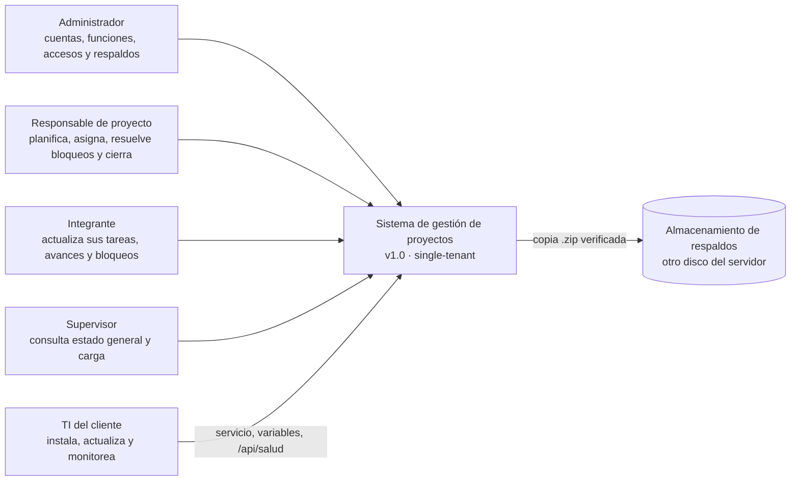
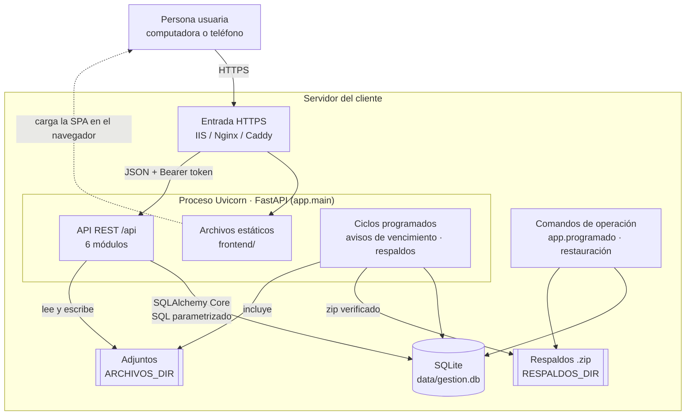
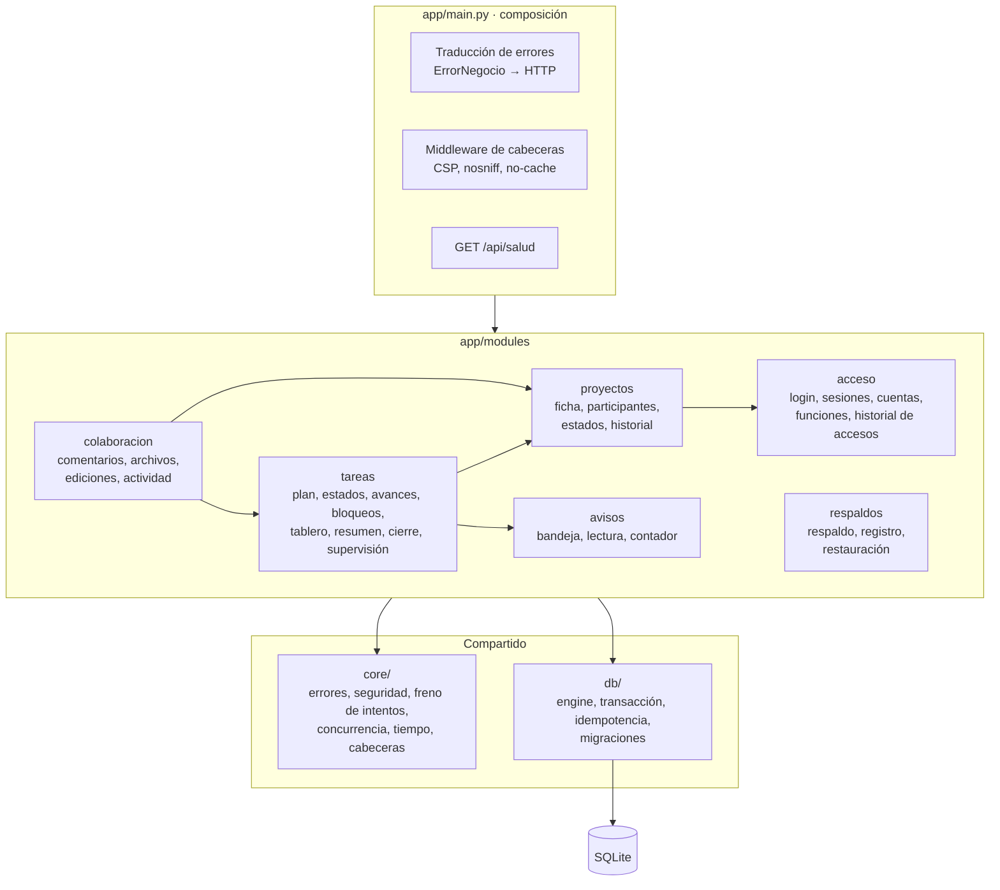
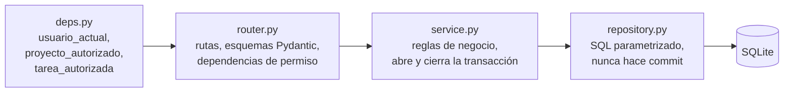
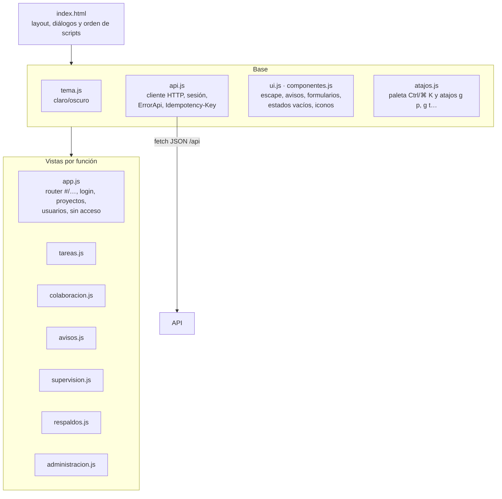
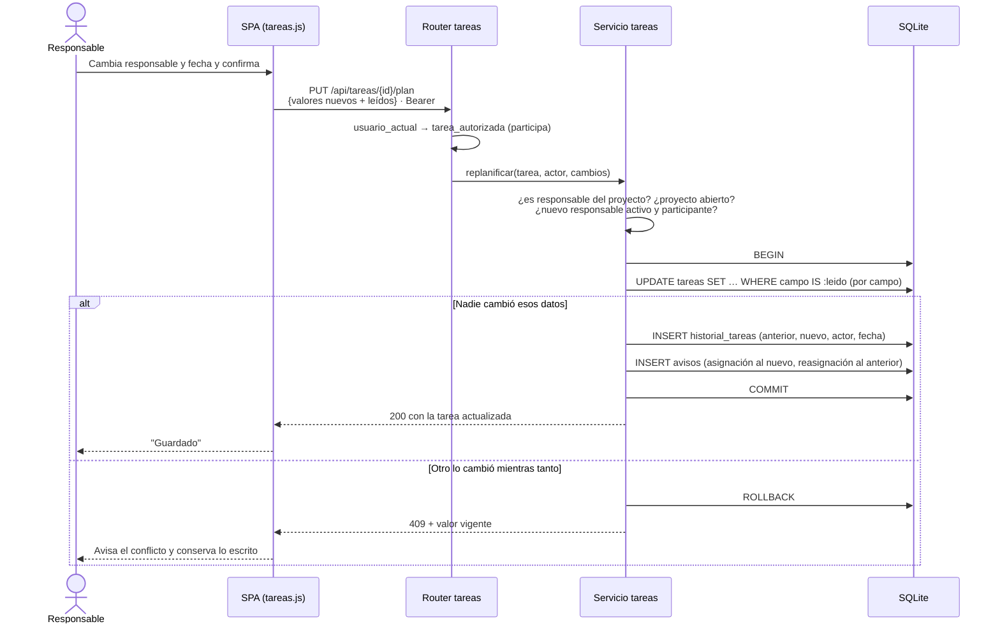
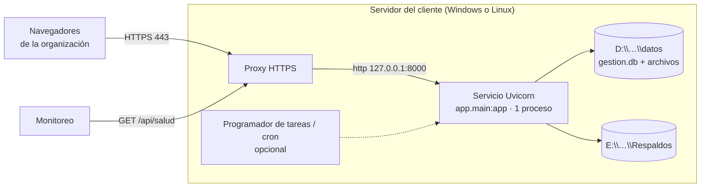

# Arquitectura del sistema de gestión de proyectos

**Versión del sistema:** 1.0.0 · **Esquema de BD:** migración `0021` · **Estado:** implementada.

Este documento describe la arquitectura **tal como está construida** en la versión 1.0, con el modelo C4 (contexto, contenedores, componentes y código), más el despliegue, los mecanismos transversales y las decisiones tomadas. Los diagramas editables están en [`docs/diagramas`](diagramas).

## 0. Resumen

- **Estilo:** monolito modular. Un solo proceso de Python (FastAPI sobre Uvicorn) sirve la API REST y la interfaz web, y además corre los procesos programados (avisos de vencimiento y respaldos).
- **Datos:** una base SQLite por cliente, con el esquema versionado por migraciones de Alembic. Los adjuntos se guardan en disco, fuera del código, y los respaldos en otra carpeta (en producción, otro disco).
- **Interfaz:** HTML, CSS y JavaScript sin frameworks ni paso de build. Es una aplicación de una sola página con rutas `#/…` que habla con la API en JSON por el mismo origen.
- **Organización interna:** seis módulos de negocio (`acceso`, `proyectos`, `tareas`, `avisos`, `colaboracion`, `respaldos`), cada uno con capas `router → service → repository`.
- **Entrega:** single-tenant. Cada cliente tiene su propia instalación y su propia base.

## 1. Contexto (C4 nivel 1)



| Función | Qué puede hacer |
|---|---|
| **Admin** | Todo lo de Responsable. Además administra cuentas (registrar, cambiar función, desactivar, restablecer acceso), consulta el historial de accesos y gestiona los respaldos. |
| **Responsable** | Crea proyectos. En los proyectos a su cargo da y retira acceso, crea y planifica tareas, resuelve bloqueos, edita el proyecto, inicia la ejecución y lo cierra. Ve el estado general y la carga. |
| **Integrante** | En los proyectos donde participa: cambia el estado de sus tareas, registra avances y bloqueos, comenta y adjunta archivos. |
| **Supervisor** | Consulta los proyectos donde participa, el estado general y la carga por responsable. |

En todos los casos el acceso a un proyecto depende de **participar** en él, incluso para el Admin. No hay registro abierto: las cuentas las crea el Admin (HU-01-001), y la primera cuenta `admin` se crea al instalar con `ADMIN_PASSWORD_INICIAL`, con cambio obligatorio en el primer ingreso. El sistema no tiene integraciones externas: los avisos se ven dentro de la aplicación y no se envía correo.

## 2. Contenedores (C4 nivel 2)



| Contenedor | Tecnología | Responsabilidad |
|---|---|---|
| **Aplicación web (SPA)** | HTML, CSS y JavaScript con scripts clásicos | Pantallas, navegación por `#/rutas`, formularios con confirmación de guardado, tema claro/oscuro, paleta de comandos (Ctrl/⌘ K) y atajos. Corre en el navegador. |
| **API REST** | Python 3.11 · FastAPI · Pydantic | Autenticación, permisos, reglas de negocio, transacciones e historial. Expone `/api/*` y `/api/salud`. |
| **Ciclos programados** | Tareas `asyncio` dentro del mismo proceso | Aviso de vencimiento cercano cada `AVISOS_CADA_MIN` (60). Revisa cada hora si toca respaldar (`RESPALDO_CADA_HORAS`, 24). |
| **Base de datos** | SQLite con claves foráneas activas · Alembic | Toda la información del negocio, el historial y el registro de respaldos. |
| **Adjuntos** | Carpeta en disco | Contenido de los archivos, con nombre interno aleatorio. Nunca se sirve como estático: solo se descarga por la API, comprobando el acceso. |
| **Respaldos** | Carpeta en otro disco | `.zip` con la copia consistente de la BD, los adjuntos y un manifiesto. No se sirve por HTTP. |
| **Comandos de operación** | `python -m app.programado [respaldo]` y `python -m app.modules.respaldos.restauracion` | Ejecutar avisos o respaldos desde el Programador de tareas y restaurar un respaldo. |

**Comunicación:**
- El navegador pide la SPA y la API al **mismo origen**, así que no hay CORS. Cada petición a la API lleva `Authorization: Bearer <token>`.
- Las creaciones llevan además `Idempotency-Key` y las ediciones mandan los valores que se leyeron.
- La API responde JSON. Los errores siempre tienen la forma `{"detail": "...", ...}` con su código: 400 datos inválidos, 401 sin sesión, 403 sin permiso, 404 no existe, 409 conflicto.
- La base y las carpetas de datos nunca están expuestas al navegador.

## 3. Componentes (C4 nivel 3)

### 3.1 API (backend)



Cada módulo sigue las mismas capas:



| Capa | Hace | No hace |
|---|---|---|
| **router** | Define las rutas, valida la entrada con Pydantic, inyecta la sesión y el recurso autorizado y llama al servicio. | No contiene reglas ni SQL. |
| **service** | Aplica permisos y reglas (transiciones de estado, bloqueos, cierre), abre la transacción con `transaccion(db)`, escribe el historial y genera los avisos en la misma transacción. Lanza `ErrorNegocio` sin saber de HTTP. | No arma respuestas HTTP. |
| **repository** | Ejecuta las consultas con SQLAlchemy Core y SQL parametrizado. Hace los `UPDATE` condicionales para la concurrencia. | Nunca confirma (`commit`). |
| **deps** | Cadena de autorización. `sesion_actual` valida el token; `usuario_actual` además exige no tener cambio de contraseña pendiente; `proyecto_autorizado` y `tarea_autorizada` exigen participación activa (si no, 403). | — |

| Módulo | Tablas principales | Épicas |
|---|---|---|
| `acceso` | `usuarios`, `funciones`, `sesiones`, `eventos_cuenta` | EP-01 |
| `proyectos` | `proyectos`, `participantes`, `historial_proyectos` | EP-02, HU-01-005/006 |
| `tareas` | `tareas`, `historial_tareas`, `avances`, `bloqueos` | EP-03, EP-04, EP-07 |
| `avisos` | `avisos` | EP-06 |
| `colaboracion` | `comentarios`, `ediciones_comentario`, `archivos` | EP-05 |
| `respaldos` | `respaldos` | HU-08-004/005 |
| `db/idempotencia` | `claves_idempotencia` | HU-08-002 |

### 3.2 Aplicación web (frontend)



- **Router por hash:** `app.js` tiene la tabla de rutas (`#/proyectos`, `#/proyectos/{id}`, `#/tareas/{id}`, `#/mis-tareas`, `#/avisos`, `#/estado-proyectos`, `#/carga`, `#/usuarios`, `#/respaldos`, `#/cambios-acceso`, `#/cambiar-contrasena`, `#/sin-acceso`). Sin token redirige al login y recuerda la ruta. Con contraseña temporal solo deja ver "Cambiar contraseña".
- **Cliente HTTP (`api.js`):** agrega el token y traduce un 401 a "sesión perdida" (vuelve al login con el motivo) y un 403 a la pantalla "Sin acceso". Expone el valor vigente cuando la API responde 409.
- **Sin código en línea:** no hay `onclick` ni estilos en línea. Los botones usan `data-accion` con delegación de eventos, lo que permite una CSP estricta (`script-src 'self'`).
- **Confirmación honesta (HU-08-001):** la interfaz dice "guardado" solo cuando el servidor respondió OK. Si falla la conexión, avisa que no se guardó nada y conserva lo escrito.
- **Responsive:** las tablas se convierten en tarjetas en el teléfono. Las pruebas E2E comprueban que no haya desbordes.

## 4. Código (C4 nivel 4): estructura del repositorio

```text
backend/
  app/
    main.py              # compone la app: routers, errores, cabeceras, /api/salud, estáticos, ciclos
    programado.py        # ciclos de avisos y respaldos (también se corren por comando)
    core/                # errors, security, intentos, concurrencia, tiempo, cabeceras, schemas
    db/                  # database (engine, transaccion, migrar, admin inicial), idempotencia
    modules/
      acceso/  proyectos/  tareas/  avisos/  colaboracion/  respaldos/
        router.py  service.py  repository.py  [schemas.py  deps.py]
  migrations/versions/   # 0001_esquema_inicial … 0021_historial_accesos
  tests/                 # test_sprint1…6, test_servicios, test_regresion_permisos, e2e/
  requirements.txt  requirements-lock.txt  requirements-e2e.txt
frontend/
  index.html
  css/                   # tokens, base, layout, componentes, vistas
  js/                    # tema, api, ui, componentes, atajos, colaboracion, tareas, avisos,
                         # supervision, respaldos, administracion, app
docs/                    # Arquitectura, Despliegue, Respaldo y restauración, diagramas/
.github/workflows/ci.yml # pruebas + E2E
```

## 5. Datos

| Grupo | Tablas |
|---|---|
| Acceso | `funciones`, `usuarios` (activo, desactivación, contraseña temporal), `sesiones` (última actividad), `eventos_cuenta` |
| Proyectos | `proyectos` (estado planificado → en curso → cerrado, datos del cierre), `participantes` (alta y retiro lógico), `historial_proyectos` |
| Tareas | `tareas` (estado, responsable, prioridad, fecha límite), `historial_tareas`, `avances`, `bloqueos` (motivo, resolución) |
| Colaboración | `comentarios` (marca de editado y retiro), `ediciones_comentario`, `archivos` (metadatos y nombre interno, retiro) |
| Avisos | `avisos` (tipo, destinatario, evento de origen, leído) |
| Operación | `claves_idempotencia`, `respaldos`, `alembic_version` |

- **Nada se borra físicamente:** las cuentas se desactivan, los participantes se retiran, los comentarios y archivos se retiran dejando constancia, y el historial solo se agrega.
- **El esquema cambia solo con migraciones.** `init_db()` aplica las pendientes al arrancar (`alembic upgrade head`), así que actualizar una instalación no pierde datos.
- **Fechas:** las fechas límite son días de calendario. "Vencida" y "por vencer" se calculan con el día de `America/Guatemala` (`ZONA_HORARIA`), no con el del servidor. Los instantes (historial, avisos) se guardan en UTC.

## 6. Mecanismos transversales

| Mecanismo | Implementación | HU |
|---|---|---|
| **Sesión** | Token aleatorio de 32 bytes. Expira tras 8 h sin actividad (`SESION_INACTIVIDAD_MIN`). El logout la elimina en el servidor. Desactivar la cuenta o restablecer el acceso invalida sus sesiones abiertas. | HU-01-003/004, 009, 011 |
| **Contraseñas** | PBKDF2-SHA256 con sal y comparación en tiempo constante. No se recortan espacios. | HU-01-001 |
| **Freno de intentos** | Tras 5 fallos con el mismo usuario, cada intento espera 2 s, 4 s, 8 s… hasta 5 min. El mensaje es genérico y no revela si la cuenta existe. | HU-01-003 |
| **Autorización** | Se deniega por defecto. La función y la participación se leen de la BD **en cada petición**, así que un cambio aplica aunque la sesión esté abierta. Un recurso de otro proyecto responde 403 sin revelar si existe. | HU-01-007, 008 |
| **Transacciones** | Solo el servicio abre la transacción. La operación, su historial y su aviso se confirman juntos o no se confirma nada. | HU-08-001 |
| **Operación única** | Las creaciones mandan `Idempotency-Key`. La clave se guarda en la misma transacción, así que un reintento devuelve lo ya creado sin duplicarlo; la misma clave usada para otra acción da 409. | HU-08-002 |
| **Sin sobrescritura** | El formulario manda lo que leyó y el repositorio actualiza campo por campo con `UPDATE … WHERE campo IS :leido`. Si otra persona cambió ese mismo dato: 409 con el valor vigente y lo escrito se conserva. Los cambios en campos distintos no chocan. | HU-08-003 |
| **Historial** | Tareas: responsable, fecha, prioridad, estado, avances y bloqueos. Proyectos: estado, responsable, fechas, nombre, objetivo y cierre. Accesos: altas, funciones, desactivaciones, restablecimientos y participación. Siempre con actor, fecha, valor anterior y nuevo. | HU-04-006, 02-003, 02-006, 01-010 |
| **Avisos** | Se crean en la transacción del evento y se ligan a su evento del historial, así que un reintento no los duplica. Nadie se avisa a sí mismo. El vencimiento cercano se avisa una vez por tarea y fecha, aunque el proceso corra muchas veces. | EP-06 |
| **Archivos** | Máximo 10 MB y solo extensiones permitidas. Se escribe primero un `.parcial` y luego se renombra, con nombre interno aleatorio. La descarga comprueba el acceso vigente. | HU-05-002 |
| **Respaldo** | Copia consistente de SQLite más los adjuntos y un manifiesto con conteos y huellas. Se escribe como `.parcial`, se verifica y se publica. Se conservan los 14 últimos y cada ejecución queda registrada. | HU-08-004 |
| **Restauración** | Verifica el respaldo antes de copiar, no pisa una BD sin `--forzar`, migra, mide el tiempo y compara contra el origen. | HU-08-005 |
| **Seguridad web** | CSP estricta, `X-Content-Type-Options: nosniff`, `Referrer-Policy`, `X-Frame-Options: DENY` y `Cache-Control: no-cache` en HTML/JS/CSS. | TEC-02 |

### Ejemplo: replanificar y reasignar una tarea



## 7. Despliegue



- **Un solo proceso**, porque SQLite y el freno de intentos (en memoria) lo asumen.
- **Configuración por variables de entorno:** `DATABASE_URL`, `ARCHIVOS_DIR`, `RESPALDOS_DIR`, `ADMIN_PASSWORD_INICIAL`, `ZONA_HORARIA`, `DIAS_POR_VENCER`, `SESION_INACTIVIDAD_MIN`, `AVISOS_CADA_MIN`, `RESPALDO_CADA_HORAS`, `RESPALDOS_CONSERVAR` y `ARCHIVO_MAX_MB`.
- **Dependencias exactas** en `requirements-lock.txt`.
- **Actualizar:** respaldo, nueva versión y arranque; las migraciones se aplican solas. Hay vuelta atrás documentada.
- **`/api/salud`** responde el estado, la versión y el esquema, o 503 si no hay BD.
- Procedimiento completo en [Despliegue](Despliegue.md) y [Respaldo y restauración](Respaldo_y_Restauracion.md).

## 8. Calidad y pipeline

| Nivel | Qué cubre |
|---|---|
| `test_servicios.py` | Reglas de negocio llamando a los servicios directamente, sin HTTP. |
| `test_sprint1.py` … `test_sprint6.py` | Criterios de aceptación de cada historia contra la API, cada prueba con su BD temporal. |
| `test_regresion_permisos.py` | Recorre **todas** las rutas: sin sesión, con cuenta desactivada o con contraseña temporal pendiente no responden; las de administración son solo del Admin; quien no participa recibe 403 sin que cambie nada. |
| `tests/e2e` (Playwright) | Recorrido completo en un navegador real con varias personas, permisos en la interfaz y uso desde el teléfono. |

GitHub Actions (`.github/workflows/ci.yml`) corre en cada push y pull request dos jobs encadenados: `test` (pytest sin E2E) y, si pasa, `e2e` (instala Chromium y corre Playwright).

## 9. Decisiones de arquitectura

| Decisión | Motivo |
|---|---|
| Monolito modular en vez de microservicios | Un cliente, un equipo pequeño y operaciones que deben ser atómicas entre módulos (tarea + historial + aviso). Los módulos son límites de código, no servidores. |
| SQLite en vez de PostgreSQL | Una organización con escritura moderada. Sin servidor de BD que instalar (no todo el equipo usa Docker). Se migra a PostgreSQL solo si el piloto muestra mucha escritura simultánea. |
| SQLAlchemy Core + Alembic | SQL explícito y parametrizado, transacciones controladas por el servicio y esquema versionado. |
| Frontend sin framework ni build | Menos dependencias y despliegue trivial (el backend sirve los estáticos), con CSP estricta. |
| Procesos programados dentro del proceso | Nada extra que instalar. Siguen disponibles como comando para el Programador de tareas y son seguros de repetir. |
| Accesos por participación, no solo por función | Cada persona ve únicamente sus proyectos, incluido el Admin. |

## 10. Limitaciones conocidas y evolución

- El token de sesión vive en `localStorage`. Mejora prevista: cookie HttpOnly/Secure/SameSite con protección CSRF y hash del token en la BD.
- El hash de contraseñas no guarda su algoritmo ni su costo. Mejora prevista: política versionada con rehash al iniciar sesión.
- Solo admite un proceso: con varios, el freno de intentos y SQLite necesitarían un almacén compartido y PostgreSQL.
- Los listados no están paginados y los avisos no salen por correo.
